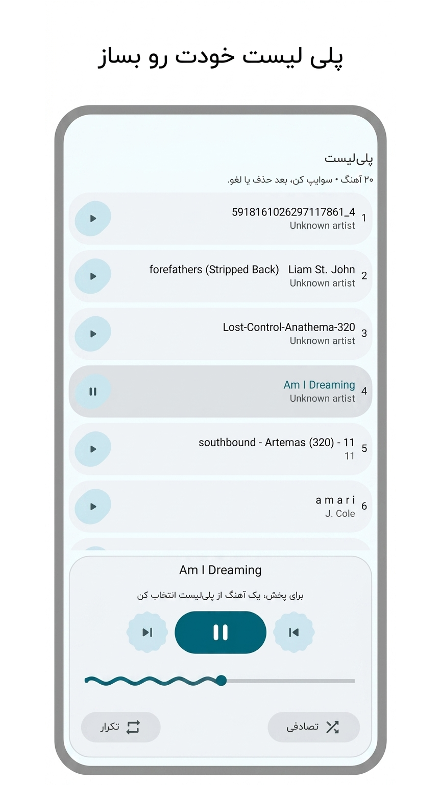

# SecMessage Android

Native Android client for SecMessage, built with Kotlin, Jetpack Compose, and a feature-based clean architecture.

## Tech Stack
- Kotlin 2.1.20 + Android Gradle Plugin 8.9.2
- Jetpack Compose (BOM 2025.06.01) + Material 3
- Hilt for dependency injection
- Ktor + OkHttp + kotlinx.serialization for API calls
- Room for local persistence
- WorkManager for background work
- Media3 ExoPlayer for audio/video playback
- Socket.IO client for realtime updates

## Project Layout
- `app/src/main/java/com/dino/message/`
  - `corefeature/` shared app core (network, utilities, base models)
  - `authfeature/` authentication flow
  - `threadfeature/` thread/post creation and timeline features
  - `chatfeature/` chat and messaging
  - `groupfeature/` group-related workflows
  - `profilefeature/` profile and account screens
  - `notificationfeature/` and `activitynotificationfeature/` notifications
  - Other feature folders follow the same `data/domain/presentation` pattern
- `app/src/main/res/` compose/theme/resources
- `tools/` local utility scripts (screenshots/tests/helpers)

## Requirements
- Android Studio (recent stable version)
- JDK 17
- Android SDK 36 (compile/target)
- Min SDK 28 device/emulator

## Configuration
Keep machine-specific values in `local.properties` (gitignored), not in committed files.

1. Copy the template:

```bash
cp local.properties.example local.properties
```

2. Set your values in `local.properties`:

```properties
APP_BASE_URL=http://10.0.2.2:5000/
AUTH_PASSWORD_REQUIRE_SYMBOL=false
```

The build resolves values in this order:
1. Gradle property (`-PAPP_BASE_URL=...`)
2. Environment variable (`APP_BASE_URL`)
3. `local.properties`
4. Fallback default (`http://10.0.2.2:5000/`)

## Build and Run
From this directory:

```bash
./gradlew :app:assembleDebug
./gradlew :app:installDebug
```

## Tests

```bash
./gradlew :app:testDebugUnitTest
./gradlew :app:connectedDebugAndroidTest
```

## Release
- Release artifact path: `app/release/app-release.apk`
- Build release APK:

```bash
./gradlew :app:assembleRelease
```

## App Screenshots




## License
This project is licensed under the GNU Affero General Public License v3.0 (AGPLv3).
See the LICENSE file for details.
